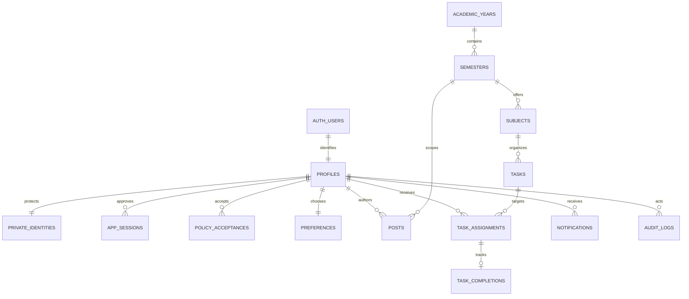

# Architecture

The PWA is Ionic Vue + Vue 3 Composition API. Components consume service methods; shared session, role, theme, language, connectivity, active term and PWA state live in Pinia. Paginated domain records belong in services/composables, not permanent global stores.

Browser → Supabase Edge Functions for username login and privileged Auth operations. Browser → PostgREST under RLS for authorized domain data. Browser → private Storage with short-lived signed URLs (milestone 6). Realtime follows the same row visibility (milestone 6). Static shell caching is isolated from backend requests.

## First migration inventory

| Table                                       | Purpose                                | Read                                                    | Write                                   |
| ------------------------------------------- | -------------------------------------- | ------------------------------------------------------- | --------------------------------------- |
| profiles                                    | Safe roster, role, account status      | Active approved sessions                                | Controlled database/admin service only  |
| private.identities                          | Internal Auth email and student number | Service only; filtered RPC for numbers                  | Service only                            |
| app_sessions                                | Approved Auth session IDs              | Own, admin                                              | Login service; revoke RPC               |
| private.login_attempts                      | Atomic per-username lockout and lease  | Service only                                            | Service-only RPC                        |
| policy_acceptances                          | Versioned policy acceptance            | Own                                                     | Onboarding RPC                          |
| preferences                                 | Language/theme                         | Own                                                     | Own constrained columns                 |
| academic_years / semesters / subjects       | Academic organization                  | Active users                                            | Academic officers, nonarchived records  |
| posts                                       | Announcement/discussion foundation     | Active published official/approved content or own/admin | Deferred until controlled workflow RPCs |
| tasks / task_assignments / task_completions | Targeted task foundation               | Managers or assigned students                           | Deferred until deadline/assignment RPCs |
| notifications                               | Private in-app messages                | Own                                                     | Server only                             |
| audit_logs                                  | Append-only sensitive actions          | President/VP                                            | Trigger or controlled service           |

## Planned domain inventory

Milestones 5–6 add account import jobs, attachment metadata, review decisions, reactions, one-level comments, mentions, content reports, moderation actions and announcement views. Milestone 7 adds polls/options/ballots (anonymous voting via aggregation RPC, never exposing identifying ballots), subject groups/members, and task workflow RPCs. Milestone 8 adds attendance sessions/records/corrections and approval requests for changes older than seven days. Milestone 9 adds contribution posts/statuses and anonymous totals RPC. Milestone 10 adds notification preferences, subscriptions, durable notification outbox, idempotent reminder jobs and events. Milestone 11 adds export events, authorized search RPC and analytics. Problem reports store only the approved sanitized metadata.

These tables intentionally have no permissive placeholder policies. Every domain requires database constraints, audited mutation paths and role-specific SQL tests before its UI is enabled.

## Entity relationships

## RLS plan

All exposed tables enable RLS. Every authenticated policy checks `private.active_session()`: the profile is active, the JWT session ID is approved and unrevoked, and the Auth session still exists. Database role lookups are authoritative; user-editable JWT metadata is never trusted. Security-definer helpers have an empty search path and qualified identifiers. All function execution grants are explicit.

Identity numbers are absent from roster rows. `student_number_for(uuid)` returns full numbers only to self or President/VP, masked values otherwise. Sensitive identity values and password material never enter audit JSON. Auth operations require service credentials in Edge Functions only. Ordinary clients cannot edit roles, active state, audit entries, session approvals or policy versions.

Academic archives deny further direct edits. Posts/tasks mutate only through the implemented business-rule RPCs. Security notices bypass category preferences. No privileged dataset is cached. See PERMISSIONS.md and SECURITY.md.

## Milestone 4 extensions

Migration `202611130003_auth_onboarding.sql` adds `notification_preferences`, a server-owned tour-completion timestamp, and private resumable password-change operations. `save_my_preferences` validates and atomically saves language, theme and categories. `complete_onboarding` requires explicit privacy/community acceptance and tour completion. Security is not an accepted preference category.

The account service loads approved session/profile/policy/preferences state; Pinia distinguishes a revoked session from a transient service failure. Failed connectivity does not erase refresh tokens. Session monitoring checks on navigation, foreground/online events and every 30 seconds while visible. RLS enforces revocation immediately, independently of UI polling. Changing user identity remounts the Ionic route outlet to discard previously cached account pages.

`my_sessions` returns only the caller's live approved devices. `revoke_my_session` verifies ownership and audits the mutation atomically. Account deactivation permanently revokes existing application sessions, including after reactivation. Login approval checks Auth-session ownership and the credential generation in the same transaction as lockout-counter reset.

The first-President provisioning RPC is service-only and requires an empty roster. The original local bootstrap script is retained as legacy reference, but is not part of the supported hosted workflow. The controlled hosted bootstrap now uses a durable singleton reservation and exact project-target checks. Hosted verification provisions only a fictional student through service-only ownership-ledger RPCs. It does not provide an in-app developer role.

Academic management now consumes paginated services with Zod input validation and the existing officer-only RLS/audit triggers. Archived parent years and semesters make descendants read-only. No domain records are held permanently in Pinia.

## Account operations

Migration 005 adds private account creation/reset records, credential leases and a one-time President reservation. Browser roles cannot read/write these tables. Authenticated administrative RPCs verify approved sessions and President/VP roles; service completion RPCs re-check the operator's live database session. Account operations never authorize from user metadata. Private student numbers remain absent from audit payloads. The member roster RPC reveals only self/admin numbers and masks others.

The admin Edge Function uses only server secrets for Auth creation/reset. Resumable creation uses the reserved UUID and verifies an Auth app-metadata ownership marker before committing profile/identity rows. These rows and audits commit transactionally. Reset intent/generation/session revocation commit before external Auth mutation; completion, recovery and notification commit afterward. The username gateway additionally compares a private expected credential fingerprint to prevent stale external writes accepting older passwords. The remaining real-service timing/failure cases stay in the hosted integration gate.

## Communication implementation (Milestone 6)

Extend existing posts with edit/moderation/deletion state; add discussion decisions, one-level comments, reactions, content reports, mention delivery records and announcement views. All mutations use role/session-checked RPCs, with ordinary direct writes denied. Safe rich text is a validated array of text/list blocks with optional bold/italic and HTTP(S) links; arbitrary HTML is never rendered. Feed priority and scheduled/expired visibility are enforced in database reads. Group/member table foundations support group mentions; their management workflows are implemented in Milestone 7.

Attachments use private Storage through an authenticated Edge Function, with parent authorization, extension/MIME/signature/size checks and metadata state transitions. Signed downloads are short-lived. Deletion remains incomplete/retryable until Storage removal succeeds, then finalizes audited database tombstones. Realtime subscriptions obey the same row visibility and are removed when leaving the view. Notifications enforce recipient category preferences before insertion.

## Groups, polls and tasks (Milestone 7)

Migrations 008–011 add retained group membership history, private poll ballots and authorized results, task targeting snapshots and server-time completion locks, and task-parent attachment authorization. UI services fetch paginated server records without placing the roster in Pinia. Anonymous ballots have no application-visible identity endpoint. Task attachment reads are limited to current assignees/managers; Storage remains private and uses the same authenticated file handler. Archived tasks retain history and attachments. Task reminders use the Milestone 10 dispatcher; hosted scheduling and delivery remain unverified.

## Completed domain architecture (Milestones 8–12)

Attendance corrections retain requested/previous states and serialize record review; changes older than seven days require President/VP approval. Contributions store integer centavos and Paid/Unpaid only. Domain writes use approved-session/role-checked RPCs; students receive only their own records. Archived data remains readable according to RLS.

Calendar reads use invoker RLS. A server-only dispatcher uses a private deduplication ledger and leased push outbox, honors category preferences and active approved sessions, and sends generic standard Web Push payloads. Provider requests are sequential and bounded. No service secret reaches the frontend.

Report RPCs validate the report discriminator before authorization, return a consistent snapshot and audit its filters/format/count. Search runs with invoker RLS. Private ballots contribute only aggregate counts to officer analytics. Export libraries are lazy-loaded. The offline view is part of the app shell so it remains reachable after disconnection; its bounded account/session-scoped cache is separate from Pinia and never authorizes mutations. See SETUP.md for cache retention and hosted/device gates.
